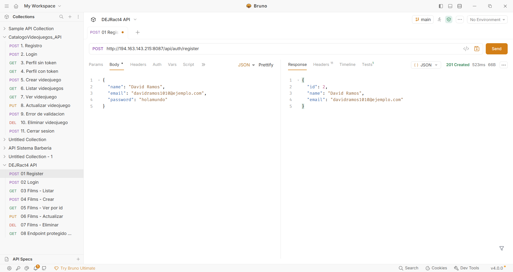
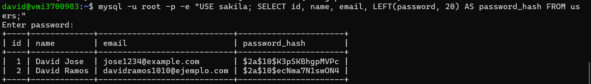
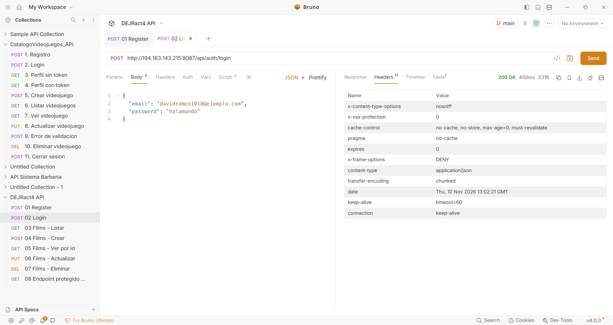
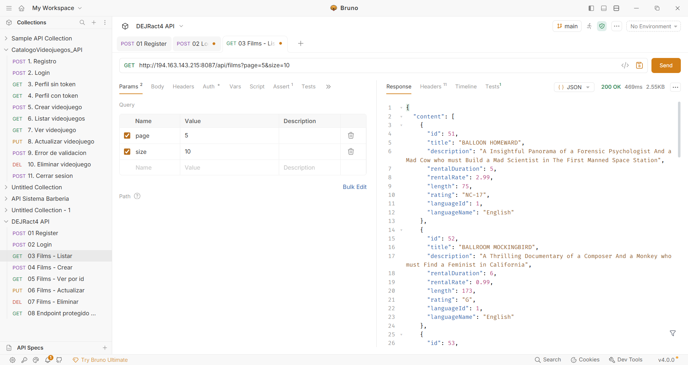
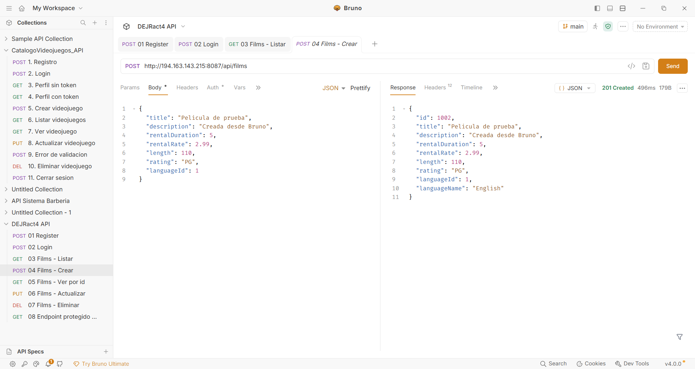
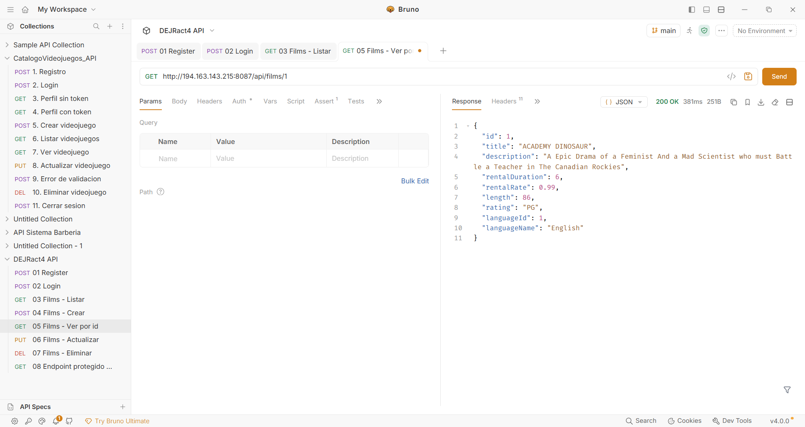
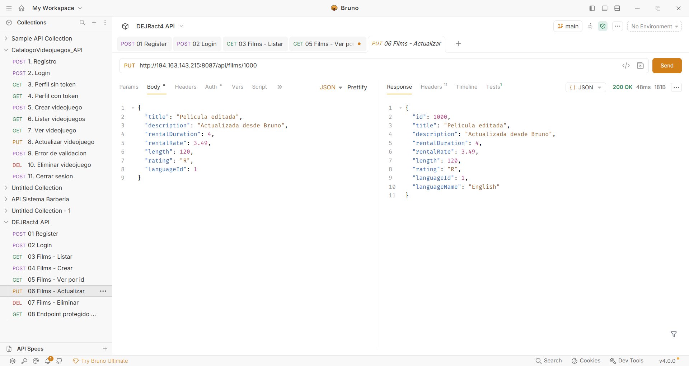
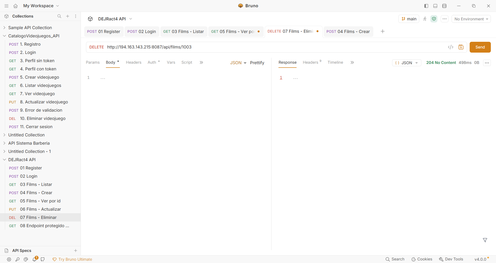
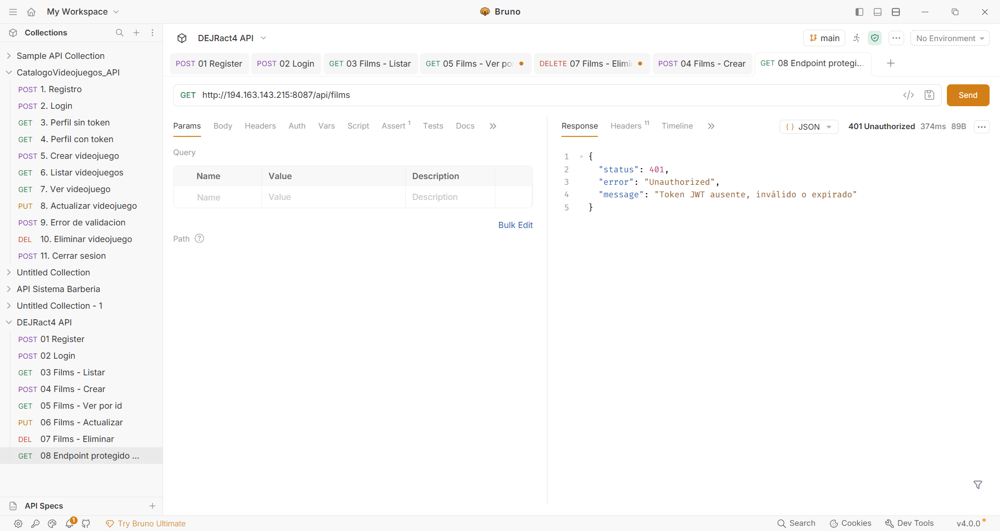

# 4. Act4. API REST con Spring Boot, Spring Security y JWT (sin frontend).
## Construí una API REST pura en Spring Boot con autenticación real mediante Spring Security y JWT, aplicando buenas prácticas de diseño de API, probada y documentada con Bruno.
#### Elaborado por: David Efraín José Ramos NL 19
***
### Preguntas de la fase tres:
##### a) ¿Qué es un JWT y qué información contiene normalmente?
Un token web JSON o JWT se compone de tres partes:

1. El encabezado: contiene algunos metadatos sobre el token en sí.

2. La carga útil: contiene los datos que queremos codificar en el token, por lo que cuantos más datos queramos codificar aquí, mayor será el JWT.

3. La firma.

Estas dos primeras partes, el encabezado y la carga útil, son simplemente texto simple que se codificará, pero no se cifrará.

Entonces cualquiera podrá decodificarlos y leerlos, no podemos almacenar ningún dato confidencial aquí. Pero eso no es un problema en absoluto porque en la tercera parte, la firma, es donde las cosas realmente se ponen interesantes. La firma se crea utilizando el encabezado, la carga útil y el secreto que se guarda en el servidor.

Y todo este proceso se llama entonces firma del Json Web Token. El algoritmo de firma toma el encabezado, la carga útil y el secreto para crear una firma única. Entonces sólo estos datos más el secreto pueden crear esta firma. Luego, junto con el encabezado y la carga útil, estas firmas forman el JWT, que luego se envía al cliente.

##### b) ¿Cómo protege Spring Security tus endpoints? ¿Qué pasa si intentas llamar uno protegido sin token?
Spring Security pone una cadena de filtros (SecurityFilterChain) delante de los controladores. En mi SecurityConfig está configurado así:
```java
/api/auth/**
```
- Cualquier otra ruta, como `/api/films`, exige autenticación.
- Las sesiones son *stateless* y CSRF está desactivado, porque la API usa tokens y no cookies.
- Mi filtro JwtAuthFilter va antes del filtro de login por defecto. Lee el header Authorization: Bearer <token>, valida la firma y la expiración con JwtService y, si el token es válido, registra al usuario como autenticado en el SecurityContext.

###### c) ¿Por qué usaste un DTO en vez de exponer directamente tu Entity en las respuestas de la API?

Usás un DTO para desacoplar los datos en tu backend, o sea, las entidades, de los datos que le mostrás a los consumidores de la API. Capaz no quieres mostrar ciertos campos. O asegurarte de que ciertos campos no se puedan escribir.

Puedes tener varios DTOs diferentes para una misma entidad, si hay diferentes casos de uso.

Lo use mas que todo por seguridad

##### d)  Pega el enlace de tu repositorio de GitHub (con el README documentado y la colección de Bruno) y el link base de tu API ya funcionando en el VPS.

Link de repositorio: https://github.com/David-Ramos1010/DEJRact4_t4

Links del VPS: http://194.163.143.215:8085

### Imagenes:

#### Registro


***
#### Login

#### Listar films

#### Crear films

#### Ver films

#### Actualizar films

#### Eliminar films

#### Sin token

#### Elaborado por: David Efraín José Ramos NL 19